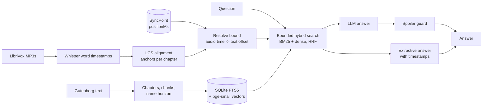

# Earmark

**A spoiler-safe listening companion for audiobooks.** Ask "who is Renfield again?" halfway through a book. Earmark answers only from what you have already heard, shows character cards that never reveal who turns up later, and finds your next listen from requests like *"a short gothic novel I can finish on a 6-hour flight"*.

[](https://github.com/JayaChandraDadi/earmark/actions/workflows/ci.yml)

It works on public-domain books: the text from Project Gutenberg, the audio from LibriVox. The listener's position comes from [SyncPoint](https://github.com/JayaChandraDadi/syncpoint), the cross-device position-sync service.

---

## Why this is harder than ordinary RAG

A normal retrieval pipeline searches the whole book. For a listener halfway through, that is the problem: the best answer to "what is Mr. Thorne hiding?" is usually in the last chapter. Earmark treats *where the listener is* as a hard constraint everywhere:

1. **Audio time → text position.** A listening position is a timestamp in an MP3, not a page. Earmark transcribes each chapter with Whisper (word timestamps), then aligns the transcript to the book's own words with a longest-common-subsequence match. Runs of 3 or more matching words become anchors: "the narrator finished the word at character X at time T". Intros ("This is a LibriVox recording..."), misheard names and read-out numbers simply do not match and are skipped.
2. **A bound that never runs ahead.** The spoiler bound is the last anchor the narrator has *finished saying*. It never interpolates forward. Chapters without a transcript fall back to constant-speed timing minus a 15-second safety margin.
3. **Bounded hybrid retrieval.** BM25 (SQLite FTS5) and dense embeddings (bge-small, ONNX) only see chunks that end before the bound, fused with reciprocal-rank fusion. The chunk the listener is in the middle of is cut at the bound and embedded on the fly, so "what just happened?" still works.
4. **Name horizon.** One pass over the text records every name as written ("Jonathan Harker", "Mr. Harker", "Mina Harker") with where it first appears. Character cards show only people and aliases already heard, and their quotes are clipped at the bound.
5. **Guarded generation.** An LLM knows how famous books end, so bounded context alone is not enough. Generated answers are rejected if they use a name the listener has not reached yet, without saying which name, because that would itself be a spoiler. Sentences the excerpts do not support are dropped. A rejected answer falls back to the extractive answer, which is spoiler-free by construction.



## Discovery

Requests are parsed deterministically into hard filters (duration, language, author, genre) plus leftover text for semantic matching:

```
$ earmark discover "a short gothic novel I can finish on a 6-hour flight"
understood: {"maxHours": 6.0, "language": "English", "genres": ["gothic"], "text": "short"}
```

Duration phrases ("under 8 hours", "for a 90 minute commute", "between 3 and 5 hours", "short" ≤ 3 h, "long" ≥ 12 h, but not "short stories"), languages ("in French"), authors ("by Mark Twain", or a bare surname like "Dickens" that the catalogue uniquely identifies) and about 25 genre families map onto LibriVox metadata. If the filters leave nothing, the genre filter is relaxed and the response says so.

## Interfaces

| Interface | Command |
|---|---|
| HTTP API (FastAPI) | `earmark serve` → `POST /v1/books/{id}/ask`, `GET /v1/books/{id}/characters`, `GET /v1/discover` |
| MCP server (stdio or streamable HTTP) | `earmark mcp`: tools `ask_about_book`, `character_guide`, `discover_audiobooks` |
| CLI | `earmark ask dracula "Who is Renfield?" --at 3:10:00`, `earmark characters dracula --listener jaya` |

Every request says where the listener is: `positionMs`, `listenerId` (looked up in SyncPoint), or `chapter`.

```bash
curl -s localhost:8090/v1/books/dracula/ask -H 'Content-Type: application/json' \
  -d '{"question": "Who is Renfield?", "listenerId": "jaya"}'
```

## Run it

```bash
python -m venv .venv && . .venv/bin/activate
pip install -e ".[all]"

# Dracula: text + LibriVox recording, align the first five chapters (tiny.en runs fine on a laptop CPU)
earmark -v ingest-book --id dracula --gutenberg 345 --title Dracula --author "Bram Stoker" \
    --librivox <librivox-id> --transcribe 1-5
earmark -v ingest-catalog

earmark characters dracula --chapter 4
earmark ask dracula "Why is Jonathan uneasy at the castle?" --chapter 3
SYNCPOINT_URL=http://localhost:8080 earmark serve
```

Optional LLM answers through any OpenAI-compatible endpoint, for example Ollama on a Mac:

```bash
EARMARK_LLM_BASE_URL=http://localhost:11434/v1 EARMARK_LLM_MODEL=llama3.2:3b earmark serve
```

## Tests

`pytest` runs 48 tests in about 2 seconds, with no network and no model downloads. They use a small fixture novel, synthetic narration and a hashing embedder.

- **Alignment:** survives an intro, dropped, substituted and inserted ASR words. Across 2,000 random instants, the spoiler bound never runs ahead of the word being spoken.
- **Retrieval:** across 300 random positions per ranker, nothing past the bound is ever returned. The in-progress chunk is truncated at the bound.
- **Names:** people are found and places are not. Cards after chapter 1 omit characters introduced in chapter 2, and a single passing mention is not yet a character.
- **Guard:** blocks a future name without revealing it, blocks a name never heard at all, and drops unsupported sentences. A leaky LLM (mocked) falls back to the extractive answer.
- **Discovery:** duration, language, author and genre parsing. Constraint filtering beats an unparsed baseline.
- **API and MCP:** end-to-end HTTP including SyncPoint lookup (mocked), and MCP tool listing and calls.

## Evaluation

`python -m earmark.evaluate all --book dracula` runs four evaluations on the real book and recording and writes them to `eval/results/`:

| Evaluation | What it measures |
|---|---|
| `spoilers` | 40 listener positions × hand-written questions. Share of answers that cite unheard text: Earmark against naive whole-book RAG. Character-card leaks. Guard catch rate on injected future names, and false blocks on honest answers |
| `retrieval` | Recall@k and MRR for BM25, dense and hybrid, with gold passages quoted verbatim from the text |
| `alignment` | Median and p90 error (seconds) of the audio→text map with nearby anchors withheld, against a constant-speed baseline |
| `discovery` | Per-field parse accuracy on 40 labelled requests, and the share of top-10 results that satisfy every stated constraint, against unparsed hybrid search |

## Layout

```
src/earmark/
  text/        Gutenberg cleaning, chapters, offset-exact chunks and sentences
  align/       Whisper transcription, LCS anchor alignment, audio<->text timeline
  index/       SQLite (FTS5 + metadata), embeddings, bounded hybrid retrieval
  companion/   name horizon, character cards, spoiler guard, extractive and guarded LLM answers
  discovery/   LibriVox catalogue, request parser, constraint-aware search
  service.py   use cases shared by api.py (FastAPI), mcp_server.py (MCP) and cli.py
  evaluate.py  the four evaluations
```

## Limits

- Character detection is heuristic (capitalisation statistics plus person and place cues), not a trained NER model. It is tuned for 19th-century prose and measured, not assumed.
- Names shared by two people (Mr. and Mrs. Harker) stay out of the cards but remain in the spoiler horizon.
- Chapters that are not transcribed use constant-speed timing with a safety margin, so the bound there is coarser.

## License

MIT. Book texts are from Project Gutenberg and recordings from LibriVox, both public domain in the USA.
